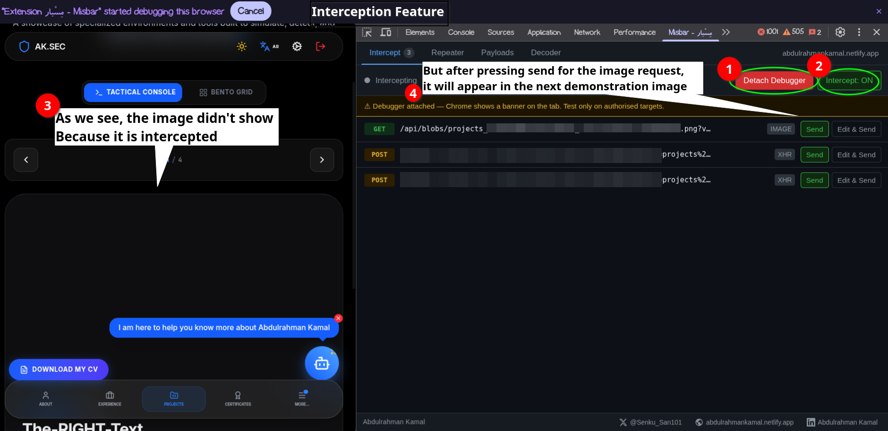
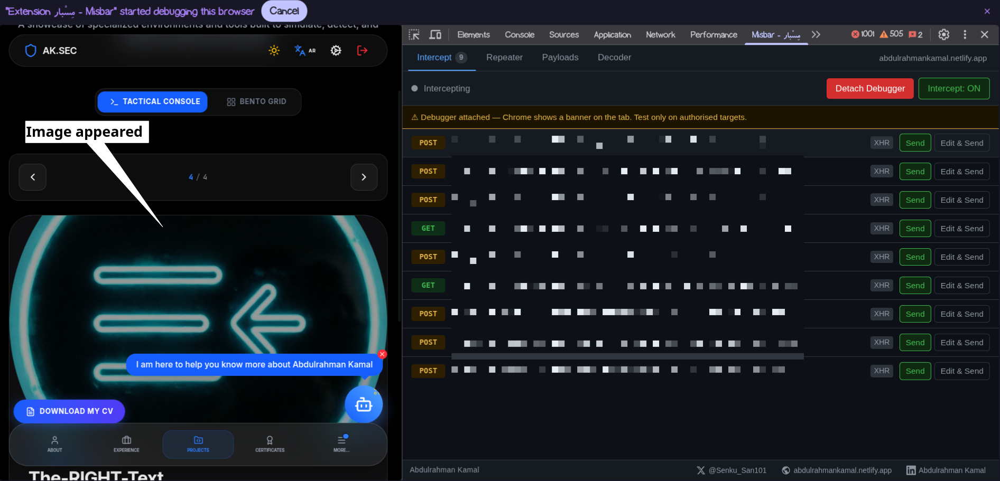
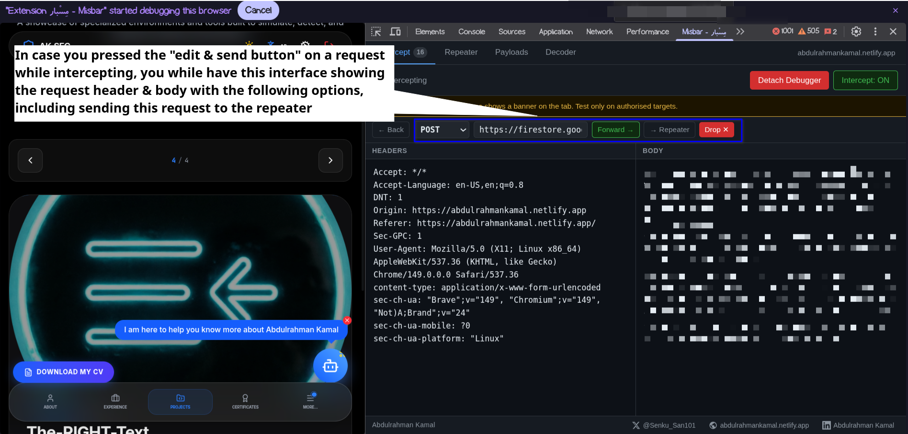
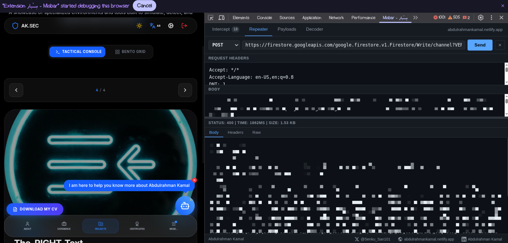
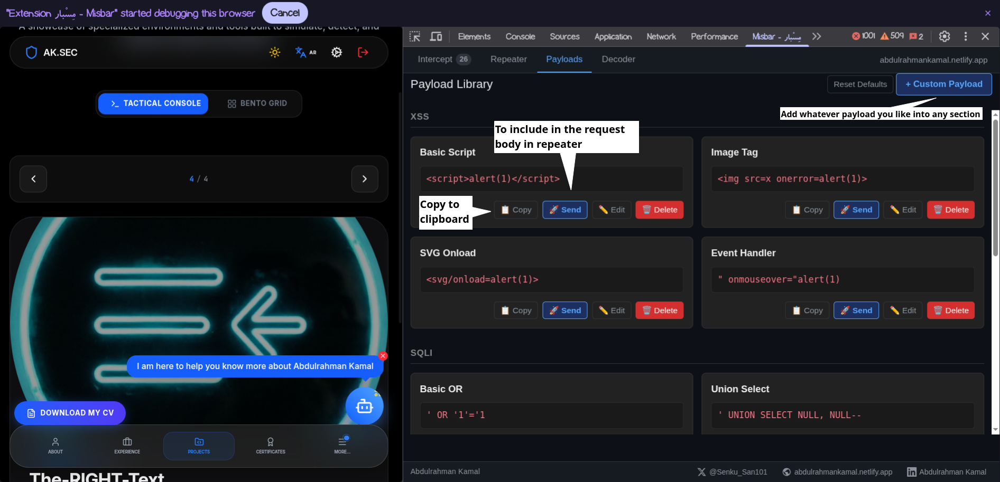
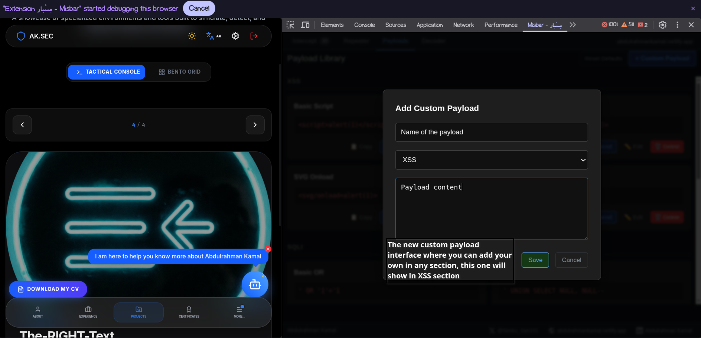
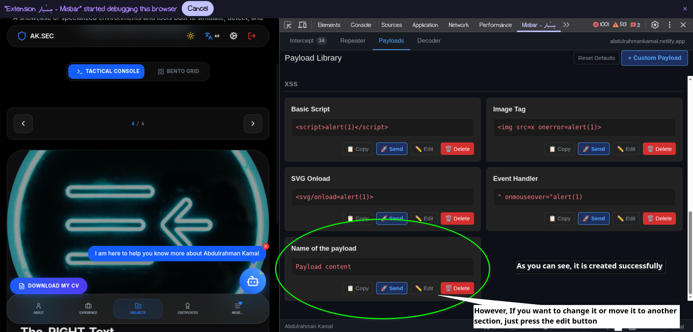
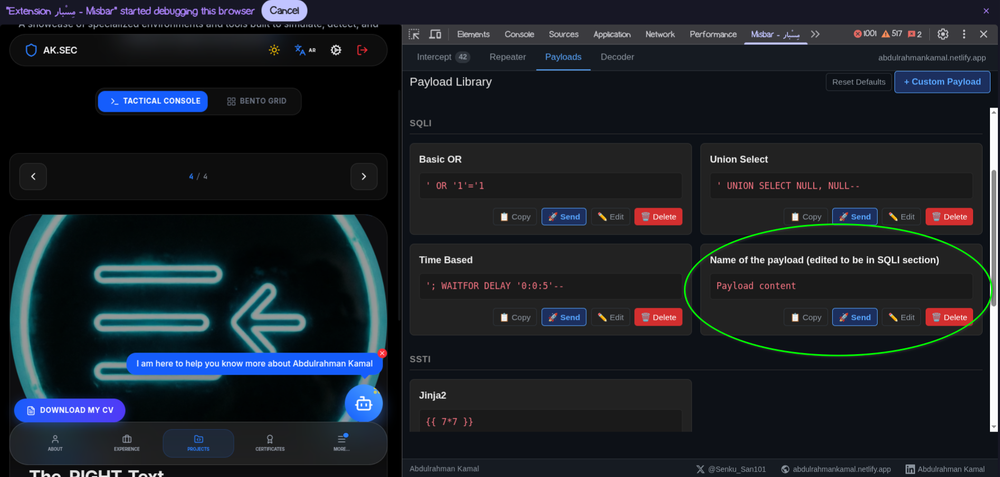
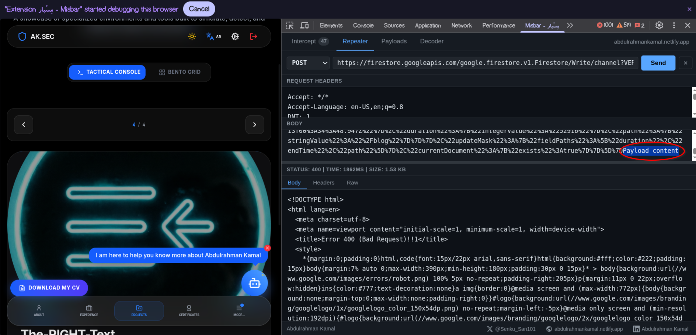
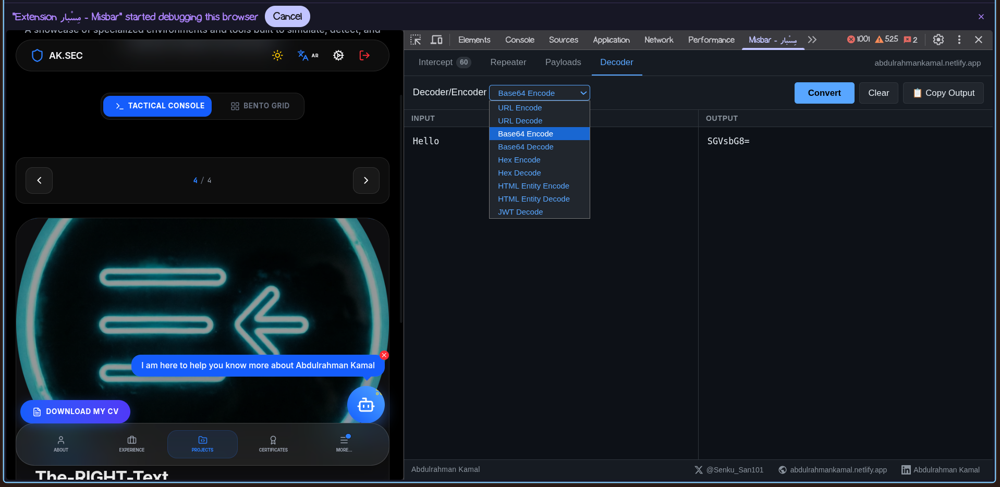

**Misbar** is a powerful, browser-native security testing extension designed for penetration testers, bug bounty hunters, and security researchers. Integrating directly into your browser's Developer Tools, Misbar provides a lightweight and immediate interface to intercept, modify, replay, and manipulate HTTP requests, removing the need to switch between external proxy tools like Burp Suite or ZAP during active testing.

## 🚀 Key Features

-   **Real-time Request Interception:** Pause inbound/outbound HTTP requests to inspect, modify, or drop them before they reach the server.
    
-   **Advanced Repeater:** Forward captured requests to a dedicated replay interface, allowing you to tweak headers, body, and methods and observe the raw server response.
    
-   **Integrated Payload Library:** Built-in collection of common attack vectors for XSS, SQLi, SSTI, and more. Quickly copy or send pre-loaded payloads.
    
-   **Custom Payload Management:** Create, edit, organize, and recategorize your own custom payloads dynamically within the UI.
    
-   **Inline Encoder/Decoder:** Instant encoding and decoding of text across multiple formats, including Base64, URL, Hex, HTML Entities, and JWT.
    

---

## 📸 Walkthrough & Feature Details

### 1\. Traffic Interception & Flow Control

**Detailed Explanation:** Misbar operates as a MITM (Man-in-the-Middle) proxy within the browser. When the **"Intercept: ON"** switch is toggled, Misbar halts network requests, preventing resources (like images or API responses) from loading on the frontend. As shown in the screenshot, the UI indicates an active interception (`Debugger attached`), and the application's image fails to render because the `GET` request is paused for manual inspection.

### 2\. Forwarding Requests & Resuming Load

**Detailed Explanation:** Once a security tester has inspected the paused request, they can simply **forward** it to the target server. The screenshot demonstrates the result: the previously blocked image successfully loads on the application interface, confirming that the interception process is non-destructive and completely reversible.

### 3\. The Request Editor (Forward, Drop, Repeater)

  
**Detailed Explanation:** Clicking **"Edit & Send"** on an intercepted request opens a comprehensive editor. This window provides a complete breakdown of the HTTP request, including the Method (`POST`), Target URL, Request Headers, and Body. From here, you have three crucial actions:

-   **Forward:** Send the request exactly as it currently sits.
    
-   **Drop X:** Abandon the request completely so it never reaches the server.
    
-   **Repeater:** Forward the current request to the dedicated _Repeater_ tab for persistent testing and manipulation.
    

### 4\. The Repeater Module (Response Analysis)

  
**Detailed Explanation:** The **Repeater** is one of the most critical tools for manual testing. It allows you to view the raw server response to your modified requests. As seen in the image, the system displays the `STATUS` code (e.g., 400 Bad Request), response `TIME`, payload `SIZE`, and the raw HTML body. Users can repeatedly tweak the body or headers on the left and hit `Send` to launch the request again, ideal for fuzzing, path traversal, or testing WAF bypasses.

### 5\. Pre-built Payload Library

  
**Detailed Explanation:** Misbar ships with a built-in **Payload Library**, pre-categorized into common vulnerability types such as XSS (Basic Script, SVG Onload), SQLi (Basic OR, Union Select, Time-Based), and SSTI (Jinja2). Each card features quick-action buttons: **Copy** (to instantly clone the payload to your clipboard for use elsewhere), **Send** (to push the payload directly into the Repeater body), **Edit**, and **Delete**.

### 6\. Creating Custom Payloads

 
**Detailed Explanation:** Recognizing that pre-built lists are rarely enough for complex engagements, Misbar features a **Custom Payload** creator. This modal allows users to assign a descriptive name to their payload, select an existing category (such as "XSS"), and paste custom code or exploitation strings.

### 7\. Instant Library Integration

  
**Detailed Explanation:** Upon clicking **Save**, the custom payload is instantly generated and visually inserted into the selected category section of the Payload Library. It mimics the exact structure of the built-in payloads, ensuring it is immediately available for reuse with the same Copy, Send, Edit, and Delete controls.

### 8\. Dynamic Payload Management & Re-categorization

  
**Detailed Explanation:** Misbar's payload system is fully editable. By clicking the **Edit** button on a custom payload, users can not only modify the payload's code but also relocate it to a completely different category. The screenshot shows a payload (originally created in XSS) being edited and moved into the **SQL** category, showcasing the tool's adaptability to a user's evolving workflow.

### 9\. Direct Payload Injection into Repeater

  
**Detailed Explanation:** This view demonstrates how the Payload Library interacts with the Repeater. The tester can push a `Payload content` variable or a specific XSS/SQL payload directly into the request body of an active test case. This automation saves time by allowing testers to cycle through various payload vectors without manually retyping them.

### 10\. Integrated Encoder/Decoder Suite

  
**Detailed Explanation:** Misbar includes a robust cryptography and formatting utility panel. Testers can leverage this to quickly encode or decode strings for testing. The dropdown menu provides support for:

-   URL Encode / Decode
    
-   Base64 Encode / Decode
    
-   Hex Encode / Decode
    
-   HTML Entity Encode / Decode
    
-   JWT Decode  
    As shown in the screenshot, entering "Hello" and selecting "Base64 Encode" instantly outputs `SGVsbG8=`, allowing for quick on-the-fly data manipulation.
    

---

## 📦 Installation (Chrome Extension)

Since Misbar runs as a Developer Tool extension, follow these steps to install it locally:

1.  Clone or download this repository to your local machine.
    
2.  Open your Chromium-based browser (Google Chrome, Brave, Microsoft Edge, etc.).
    
3.  Navigate to the Extensions management page: `chrome://extensions`.
    
4.  Toggle **Developer mode** on (usually located in the top right corner).
    
5.  Click the **Load unpacked** button.
    
6.  Select the folder containing the Misbar source code.
    
7.  Open your browser's Developer Tools (**F12** or **Right Click > Inspect**) and look for the newly added **Misbar** tab.
    

---

## 💻 Usage Guide

1.  **Starting a Test:** Navigate to your target web application and open the Developer Tools > **Misbar** tab.
    
2.  **Interception:** Toggle the `Intercept: ON` switch in the main dashboard.
    
3.  **Editing:** When a request is intercepted, click **Edit & Send** to view the raw HTTP data.
    
4.  **Replaying:** Forward a request to the **Repeater** to edit and resend it multiple times while viewing the server's specific response codes and bodies.
    
5.  **Expanding:** If you need a specific payload for a proprietary vulnerability, use the **Payloads** tab to add it to your library.
    

---
